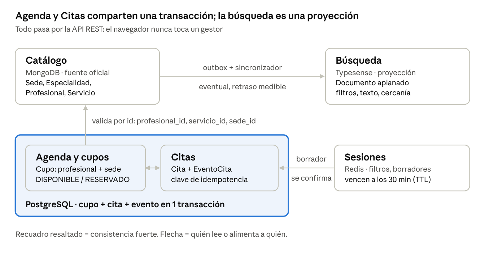
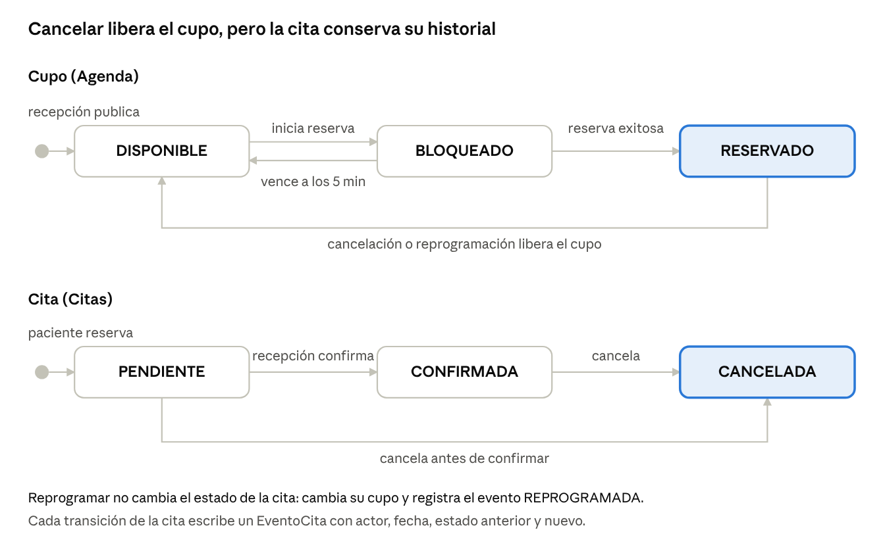
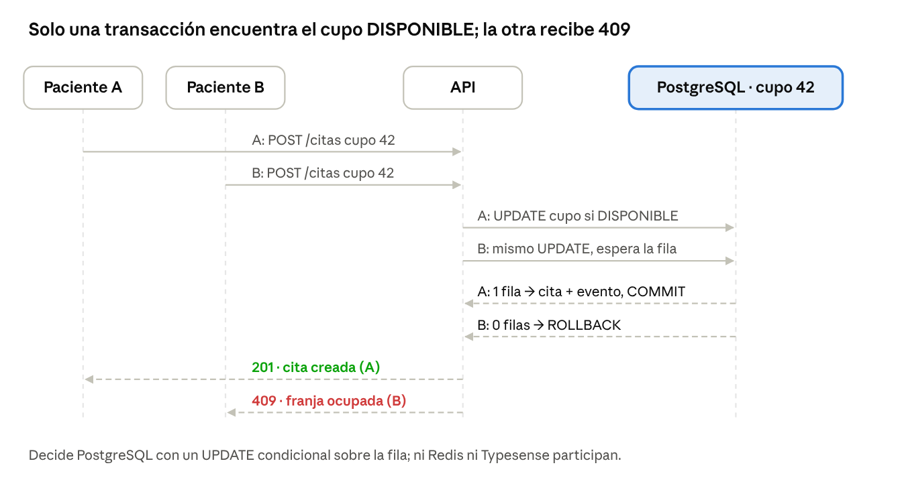

# Fase 1 · Comprensión — Caso 1 Clínica ambulatoria

Grupo 2 · Daniel Guevara, Nicolás García, Camila Barrionuevo · 29 de octubre de 2026

Producto de control: **mapa de dominio y flujos**.

## 1. Contexto, objetivo y alcance

Una red de consultorios necesita una web donde pacientes ficticios consulten servicios y profesionales, reserven citas y sigan su estado, mientras recepción gestiona la agenda. El reto central es **evitar reservas duplicadas** y ofrecer **búsquedas ágiles** por especialidad, horario y ubicación.

**Objetivo del sistema:** web → API REST → módulos de dominio → gestores, con al menos tres tecnologías de persistencia justificadas, todo ejecutado con Docker Compose.

| Dentro de alcance | Fuera de alcance |
| --- | --- |
| Catálogo de profesionales, servicios, sedes y especialidades | Historia clínica y diagnóstico |
| Publicación de franjas y control de cupos | Pagos reales o facturación |
| Reserva, cancelación y reprogramación de citas con historial | Datos personales o clínicos reales |
| Búsqueda y filtros por especialidad, sede, texto y horario | Notificaciones reales (correo, SMS) |
| Estado temporal: filtros, sesiones y borradores con vencimiento | Integración con sistemas externos de la clínica |
| Pantalla técnica del sincronizador (opcional) | Alta disponibilidad multi-nodo |

## 2. Actores, roles y permisos

Hay tres roles humanos y un actor de sistema. La API valida el rol en cada operación y nunca confía en horarios o estados enviados por el navegador.

| Actor | Objetivo | Operaciones principales |
| --- | --- | --- |
| Paciente (ficticio) | Encontrar atención y asegurar una cita | Buscar, ver ficha y disponibilidad, reservar, cancelar y ver sus citas |
| Recepcionista | Mantener la agenda ordenada | Publicar franjas, confirmar, reprogramar y cancelar citas de cualquier paciente |
| Administrador | Mantener la oferta actualizada | Crear, editar y desactivar profesionales, sedes, especialidades y servicios |
| Sincronizador (sistema) | Mantener la búsqueda al día | Leer cambios del catálogo y actualizar la proyección de búsqueda |

**Matriz de permisos** (✓ = permitido, P = solo sobre lo propio):

| Operación | Paciente | Recepcionista | Administrador |
| --- | --- | --- | --- |
| Buscar y ver catálogo | ✓ | ✓ | ✓ |
| Gestionar catálogo | | | ✓ |
| Publicar o bloquear franjas | | ✓ | ✓ |
| Reservar cita | P | ✓ | |
| Cancelar cita | P | ✓ | |
| Confirmar cita | | ✓ | |
| Reprogramar cita | P | ✓ | |
| Ver citas | P | ✓ | ✓ |
| Ver estado del sincronizador | | | ✓ |

## 3. Glosario del dominio

Estos términos se usan igual en el código, la API, la base de datos y la defensa.

| Término | Significado |
| --- | --- |
| Sede | Consultorio físico con dirección y coordenadas ficticias |
| Especialidad | Área médica (Pediatría, Dermatología…) que agrupa profesionales y servicios |
| Profesional | Médico ficticio con especialidades, idiomas, sedes y modalidades |
| Servicio | Prestación reservable (ej. consulta general) con duración y modalidad |
| Modalidad | Forma de atención: presencial o teleconsulta |
| Horario de referencia | Horario habitual informativo de la ficha; no es reservable |
| Franja / Cupo | Bloque concreto de tiempo de un profesional en una sede, reservable una sola vez |
| Disponibilidad | Conjunto de cupos en estado DISPONIBLE |
| Bloqueo temporal (hold) | Reserva provisional de un cupo durante el formulario, con vencimiento |
| Cita | Compromiso de un paciente con un cupo y un servicio; tiene estado e historial |
| Evento de cita | Registro inmutable de un cambio de estado: quién, cuándo, de qué a qué |
| Reprogramación | Cambio de una cita a otro cupo, liberando el anterior |
| Borrador de reserva | Selección en curso (profesional, servicio, franja) guardada temporalmente |
| Proyección de búsqueda | Copia derivada y aplanada del catálogo, optimizada para filtrar |
| Clave de idempotencia | Identificador que envía el cliente para que un reintento no duplique la reserva |
| Source of Truth | Gestor que tiene la versión oficial de un dato |

## 4. Dominios de negocio

Los cinco dominios los fija el enunciado. Agenda y Citas exigen consistencia fuerte; Búsqueda y Sesiones toleran consistencia eventual o pérdida controlada. El gestor propuesto se valida en la Fase 2.

| Dominio | Responsabilidad | Entidades | Operaciones mínimas | Consistencia | Gestor propuesto |
| --- | --- | --- | --- | --- | --- |
| Catálogo | Fuente oficial de la oferta | Sede, Especialidad, Profesional, Servicio | Crear, editar, desactivar, ver ficha | Fuerte en su escritura | MongoDB |
| Agenda y cupos | Controlar qué franjas existen y quién las ocupa | Cupo (franja) | Publicar, bloquear, confirmar, liberar | Fuerte (crítica) | PostgreSQL |
| Citas | Registrar el compromiso y su historial | Cita, EventoCita, ClaveIdempotencia | Reservar, consultar, reprogramar, cancelar | Fuerte (crítica) | PostgreSQL |
| Búsqueda | Responder filtros rápidos | DocumentoBúsqueda (proyección) | Buscar, filtrar, ordenar | Eventual | Typesense |
| Sesiones y preferencias | Guardar estado temporal | Sesión, FiltrosGuardados, BorradorReserva | Crear, recuperar, caducar | Efímera (TTL) | Redis |

**Source of Truth por dato:**

- **Profesionales, servicios, sedes, especialidades:** Catálogo. La Búsqueda solo tiene una copia.
- **Cupos y su estado:** Agenda. Nunca la caché ni el índice.
- **Citas e historial:** Citas.
- **Filtros y borradores:** Sesiones. Si se pierden, el usuario los vuelve a elegir; no hay pérdida de negocio.

## 5. Mapa de dominio

Los dominios se conectan por identificadores, no por claves foráneas entre gestores: `profesional_id`, `servicio_id` y `sede_id` nacen en Catálogo y se copian en Agenda y Citas. El único enlace transaccional es Agenda ↔ Citas, porque viven en la misma base PostgreSQL.

## 6. Reglas de negocio

Las reglas RN-01 a RN-08 son de consistencia fuerte y se validan en el registro autoritativo; el resto admite consistencia eventual o es de validación.

| ID | Regla | Dominio | Origen en el enunciado |
| --- | --- | --- | --- |
| RN-01 | Un cupo solo puede tener una cita activa (PENDIENTE o CONFIRMADA) | Agenda / Citas | §3, §6, flujo 3 |
| RN-02 | La confirmación de un cupo se decide en el registro autoritativo, nunca en caché o índice | Agenda | §6, §12 |
| RN-03 | Cada reserva tiene un identificador único y una clave de idempotencia; un reintento devuelve la misma cita | Citas | §6 |
| RN-04 | Cancelar libera el cupo pero conserva la cita y todo su historial | Citas / Agenda | §6, prueba 4 |
| RN-05 | Reprogramar libera el cupo anterior y ocupa el nuevo en una sola operación; si el nuevo no está libre, nada cambia | Citas / Agenda | flujo 4 |
| RN-06 | Todo cambio de estado de una cita registra estado anterior, nuevo, actor y fecha | Citas | §3 trazabilidad |
| RN-07 | Un bloqueo temporal de cupo vence si no se confirma (ej. 5 minutos) y el cupo vuelve a DISPONIBLE | Agenda | §3 |
| RN-08 | No se puede reservar un cupo pasado, ni de un profesional o servicio desactivado | Citas / Catálogo | §12 validaciones |
| RN-09 | Los cupos de un mismo profesional no pueden solaparse en el tiempo | Agenda | Supuesto del equipo |
| RN-10 | La duración del cupo corresponde a la duración del servicio | Agenda / Catálogo | §3 |
| RN-11 | Desactivar un profesional no borra sus datos ni sus citas históricas; solo deja de ofrecerse | Catálogo | §3 desactivar |
| RN-12 | La búsqueda es una proyección: puede ir con retraso y debe poder reconstruirse desde el catálogo | Búsqueda | §6 |
| RN-13 | Si la búsqueda cae, la reserva sigue funcionando; si cae Redis, se pierden borradores pero no citas | Todos | §6 |
| RN-14 | Un paciente solo ve y modifica sus propias citas | Citas | §2 |
| RN-15 | Todos los datos son ficticios y ningún secreto llega al navegador | Todos | §12 |

## 7. Máquinas de estado

Cupo y Cita cambian juntos en la misma transacción de PostgreSQL. Cualquier transición que no esté dibujada (ej. CANCELADA → CONFIRMADA) la API la rechaza con 409, y una cita cancelada nunca vuelve a activarse: para usar el horario se crea una cita nueva.

## 8. Historias de usuario

Son 14 historias: 13 de Must (obligatorias por el enunciado) y 1 de Could (opcional). Cada una tiene criterios de aceptación verificables en la defensa.

| ID | Como… | Quiero… | Para… | Criterios de aceptación | Prioridad |
| --- | --- | --- | --- | --- | --- |
| HU-01 | Administrador | crear y editar especialidades y sedes | tener la base del catálogo | Se guardan en Catálogo; nombre único; aparecen en los filtros | Must |
| HU-02 | Administrador | crear un profesional con atributos variables | publicar su ficha | Acepta idiomas, sedes y modalidades variables; aparece en la búsqueda tras sincronizar | Must |
| HU-03 | Administrador | crear un servicio con duración y modalidad | que pueda reservarse | Duración > 0; vinculado a una especialidad | Must |
| HU-04 | Administrador | desactivar un profesional o servicio | dejar de ofrecerlo sin perder historial | Desaparece de la búsqueda; sus citas pasadas siguen visibles; no admite nuevas reservas | Must |
| HU-05 | Paciente | buscar por especialidad, sede y texto | encontrar atención rápido | Filtros combinables; resultados ordenables; si la búsqueda cae, aparece un mensaje claro | Must |
| HU-06 | Paciente | ver la ficha de un profesional y sus franjas | elegir horario | Las franjas se leen de Agenda (autoritativo), no del índice | Must |
| HU-07 | Paciente | reservar una franja | asegurar mi cita | Devuelve el ID de la cita; si el cupo está ocupado, muestra error 409 visible; un reintento no duplica | Must |
| HU-08 | Paciente | ver mis citas | seguir su estado | Lista solo las propias con estado e historial | Must |
| HU-09 | Paciente | cancelar una cita | liberar el horario | Estado CANCELADA, cupo DISPONIBLE, evento registrado | Must |
| HU-10 | Recepcionista | publicar franjas por profesional y sede | abrir agenda | No se solapan; duración según el servicio | Must |
| HU-11 | Recepcionista | confirmar una cita pendiente | asegurar la agenda | Pasa de PENDIENTE a CONFIRMADA con evento | Must |
| HU-12 | Recepcionista | reprogramar una cita | adaptarme a cambios | Cupo viejo liberado y nuevo ocupado de forma atómica; la web refleja ambos | Must |
| HU-13 | Paciente | que mis filtros y borrador se recuerden un rato | no repetir pasos | Se recuperan antes del vencimiento; tras el TTL desaparecen | Must |
| HU-14 | Administrador | ver el estado del sincronizador | detectar retrasos | Muestra eventos pendientes, último sincronizado y retraso; sin credenciales | Could |

## 9. Flujos integrales obligatorios

Cada paso indica el dominio y el gestor que actúa. Los flujos 2 y 3 son el núcleo de la defensa; el diagrama de la reserva concurrente va al final de esta sección.

**Flujo 1 — Alta en catálogo y aparición en búsqueda** (HU-01 a HU-03)

1. El administrador crea una especialidad, un profesional y un servicio desde el panel.
2. La API valida y escribe en Catálogo (MongoDB); en la misma escritura registra un evento en la outbox.
3. El sincronizador lee el evento y hace upsert del documento aplanado en Búsqueda (Typesense).
4. El paciente busca por especialidad y el profesional aparece. Se mide el tiempo entre el paso 2 y el 4.

**Flujo 2 — Filtrar, ver franjas y reservar** (HU-05 a HU-07, HU-13)

1. El paciente filtra por especialidad y sede; la consulta va a Búsqueda. Los filtros se guardan en Sesiones (Redis, TTL).
2. Abre la ficha: los datos vienen de Catálogo y las franjas de Agenda (PostgreSQL).
3. Elige una franja; se guarda el borrador de reserva en Redis.
4. Envía la reserva con su clave de idempotencia. La API verifica en Catálogo que profesional y servicio estén activos.
5. En una transacción de PostgreSQL: el cupo pasa a RESERVADO, se crea la cita PENDIENTE y su primer evento.
6. Se borra el borrador de Redis y la web muestra la confirmación con el ID; la disponibilidad baja en uno.

**Flujo 3 — Reserva concurrente de la misma franja** (RN-01, RN-02)

1. Los pacientes A y B envían la reserva del mismo cupo casi al mismo tiempo.
2. Ambas transacciones intentan pasar el cupo de DISPONIBLE a RESERVADO.
3. PostgreSQL serializa el cambio sobre la fila: solo una actualización encuentra el cupo DISPONIBLE.
4. A recibe 201 con su cita; B recibe 409 "franja ya no disponible" y la web le ofrece otras franjas.

**Flujo 4 — Reprogramación por recepción** (HU-12, RN-05)

1. Recepción abre la cita y elige un cupo nuevo libre.
2. En una transacción: el cupo nuevo pasa a RESERVADO, el viejo a DISPONIBLE, la cita cambia de cupo y se registra el evento REPROGRAMADA.
3. Si el cupo nuevo ya fue tomado, la transacción se revierte y nada cambia.
4. La web del paciente y la agenda muestran el nuevo horario y el cupo anterior disponible.

**Flujo 5 — Cambio en el catálogo y actualización de la búsqueda** (RN-12)

1. El administrador cambia la sede o especialidad de un profesional en Catálogo.
2. Se registra el evento en la outbox con fecha y hora.
3. El sincronizador lo procesa y actualiza Typesense; guarda la hora de aplicación.
4. La pantalla técnica muestra el retraso medido. Si Typesense está apagado, el evento queda pendiente y se aplica al volver.

El paciente B no ve un error técnico: la web le muestra "esta franja acaba de ser reservada" y le ofrece las siguientes franjas libres.

## 10. Trazabilidad con las pruebas de la defensa

Las 5 pruebas de la defensa quedan cubiertas por al menos un flujo, una historia y una regla.

| Prueba de defensa (§7) | Flujo | Historias | Reglas | Gestores involucrados |
| --- | --- | --- | --- | --- |
| P1. Registrar profesional y verlo en la búsqueda | 1 | HU-02, HU-05 | RN-12 | MongoDB → Typesense |
| P2. Cambiar especialidad o sede y medir el retraso | 5 | HU-02, HU-14 | RN-12 | MongoDB → Typesense |
| P3. Dos reservas del mismo horario, solo una confirmada | 3 | HU-07 | RN-01, RN-02, RN-03 | PostgreSQL |
| P4. Cancelar y volver a reservar el horario liberado | 2 | HU-09, HU-07 | RN-04 | PostgreSQL |
| P5. Reiniciar contenedores y apagar la búsqueda | 2, 5 | HU-08, HU-05 | RN-13 | Todos (volúmenes) |

**Pantallas mínimas (§5) → historias:**

| Pantalla | Historias |
| --- | --- |
| Inicio con buscador y filtros | HU-05, HU-13 |
| Detalle de profesional o servicio con disponibilidad | HU-06 |
| Formulario de reserva con confirmación o error | HU-07 |
| Mis citas | HU-08, HU-09, HU-12 |
| Panel de recepción y administración | HU-01 a HU-04, HU-10 a HU-12 |
| Pantalla técnica (opcional) | HU-14 |

## 11. Restricciones de integridad y seguridad

El §12 del enunciado tiene cinco puntos; los desglosamos en seis restricciones verificables. Cada una tiene una medida concreta y una forma de comprobarla en la defensa.

| ID | Restricción (§12) | Cómo la cumplimos | Cómo se comprueba |
| --- | --- | --- | --- |
| RS-01 | Datos personales, coordenadas y evidencias exclusivamente ficticios | Datos semilla inventados (pacientes, profesionales y coordenadas de sedes imaginarias); sin historia clínica ni diagnóstico | Revisión de `db/seed/` |
| RS-02 | Evitar exponer puertos de las bases de datos más allá del equipo de práctica | En Docker Compose solo la web y la API publican puertos; PostgreSQL, MongoDB, Typesense y Redis quedan en la red interna. Si hace falta inspeccionarlos, se publican solo en `127.0.0.1` | `docker compose ps` muestra que los gestores no tienen puertos públicos |
| RS-03 | No colocar contraseñas en el frontend ni registrar secretos en el repositorio; usar `.env.example` | Credenciales solo en `.env` (excluido por `.gitignore`); se versiona `.env.example` con valores ficticios. La web solo conoce la URL de la API | `git ls-files` no lista `.env`; el código de `web/` no contiene credenciales |
| RS-04 | La API valida tipos, estados y autorizaciones; no confía en precios, horarios, capacidades o estados enviados por el navegador | Pydantic valida tipos (422). La API lee horario, duración y estado del cupo desde PostgreSQL y el Catálogo, nunca del cuerpo de la petición. El rol sale del JWT (403 si no corresponde). El caso no maneja precios | Enviar desde `/docs` un estado u horario falso y ver el rechazo |
| RS-05 | Caché o motor de búsqueda no son fuente única de una operación que requiere confirmación consistente | La reserva siempre se decide en PostgreSQL; Typesense solo muestra resultados y Redis solo guarda borradores (RN-02) | Prueba P3, y apagar Typesense o Redis durante una reserva |
| RS-06 | Registrar errores, presentar respuesta clara al usuario y documentar cuándo una operación puede reintentarse con seguridad | Logs en la API; errores con código y mensaje legible (409, 422, 503). Reintento seguro: `POST /citas` con clave de idempotencia, todas las lecturas y la sincronización (upsert) | Tabla de reintentos en la especificación de la API (Fase 3) |

## 12. Supuestos

**Supuestos del equipo:**

- La autenticación es simple: usuarios semilla por rol con JWT. No se implementa registro abierto.
- Una cita reservada por el paciente nace PENDIENTE y recepción la confirma. Si recepción la crea, nace CONFIRMADA.
- El paciente puede reprogramar sus propias citas, porque la pantalla "Mis citas" lo pide.
- Un cupo pertenece a un profesional, una sede y un servicio, y dura lo que dura el servicio.
- El bloqueo temporal de cupo dura 5 minutos; el borrador y los filtros en Redis duran 30 minutos.
- Las coordenadas de las sedes son ficticias y sirven para ordenar por cercanía.
- Una cita no se puede cancelar después de su hora de inicio.

