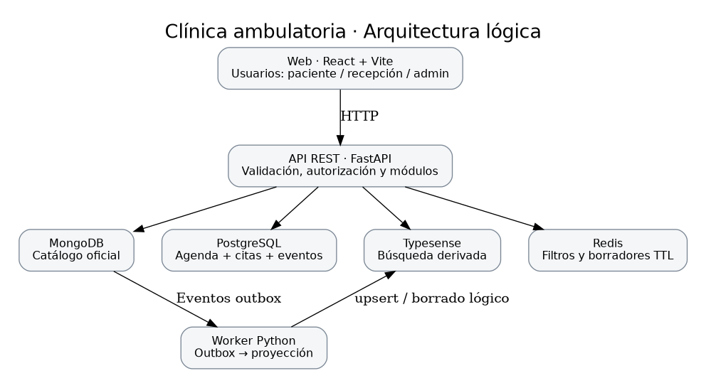
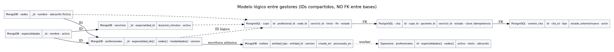
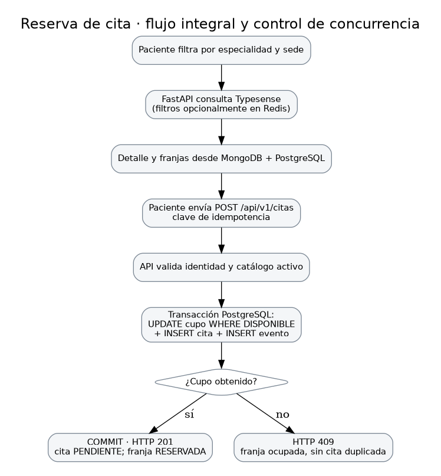
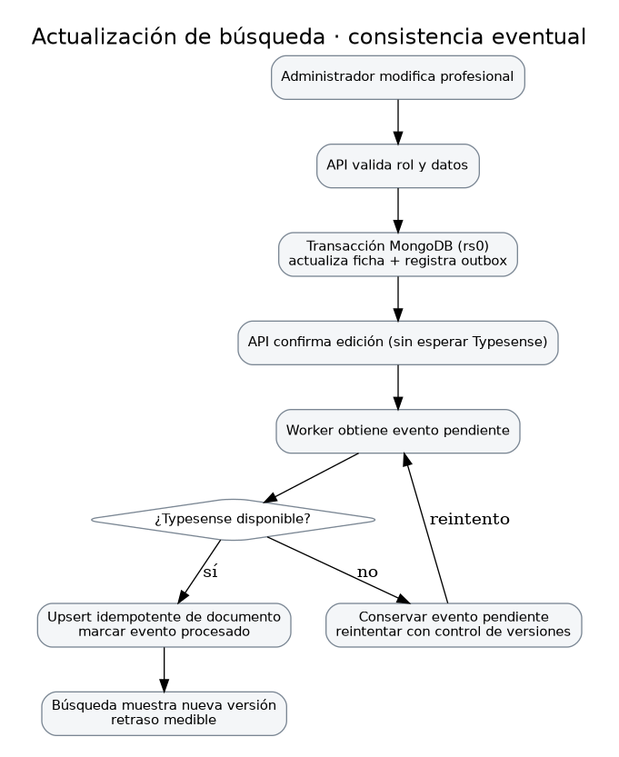

# Fase 3 · Diagramas, pantallas y consistencia — Clínica ambulatoria

**Grupo 2 · Proyecto A.** Complementa `docs/fase3-diseno.md` y `docs/api-contratos.md`. Es un **diseño propuesto**, no una declaración de que la aplicación esté programada. Conserva las decisiones de las fases 1 y 2.

## 1. Diagramas definitivos de diseño

### 1.1 Arquitectura general



La web React solo consulta la API FastAPI. La API consulta el catálogo oficial en MongoDB, disponibilidad y citas en PostgreSQL, búsqueda derivada en Typesense y preferencias temporales en Redis. El worker sincroniza MongoDB hacia Typesense mediante eventos `outbox`.

### 1.2 Modelo lógico de datos



Los identificadores `profesional_id`, `sede_id` y `servicio_id` son compartidos entre gestores **sin claves foráneas entre MongoDB y PostgreSQL**. Sí existen claves foráneas internas entre `cupo`, `cita` y `evento_cita`.

### 1.3 Flujo end-to-end: búsqueda y reserva



**Precondición:** usuario autenticado con rol Paciente o Recepción y un cupo futuro publicado. Tras buscar en Typesense, la disponibilidad final se consulta en PostgreSQL. `POST /api/v1/citas` valida catálogo activo e identidad, y obtiene el cupo mediante un `UPDATE` condicional. La transacción inserta la cita y el evento; solo una petición concurrente obtiene `201`, la otra recibe `409`. La idempotencia vincula la clave al actor y a la petición.

### 1.4 Flujo end-to-end: edición y proyección de búsqueda



El administrador actualiza MongoDB. La misma transacción registra un evento outbox; el worker realiza un upsert idempotente en Typesense y confirma el procesamiento. Si Typesense está fuera de servicio, el evento permanece pendiente y se reintenta. El retraso de proyección se mide entre `creado_en` y `procesado_en`. La fuente oficial sigue siendo MongoDB.

## 2. Diseño de pantallas (wireframes funcionales, sin implementación)

Los elementos siguientes representan los campos mínimos propuestos. Los datos mostrados serán ficticios.

### P1. Inicio y búsqueda — Paciente

```text
┌─────────────────────────────────────────────────────┐
│ CLÍNICA             Buscar   Mis citas    Ingresar  │
├─────────────────────────────────────────────────────┤
│ Buscar profesionales y servicios                    │
│ [Texto de búsqueda_________________] [Buscar]       │
│ Especialidad [▼]   Sede [▼]   Modalidad [▼]         │
│ Ordenar [Relevancia ▼]                               │
│ ┌─────────────────────────────────────────────────┐ │
│ │ Profesional · especialidad · sede · Ver ficha    │ │
│ └─────────────────────────────────────────────────┘ │
│ [Error/aviso si la búsqueda no está disponible]      │
└─────────────────────────────────────────────────────┘
```

**API:** `GET /api/v1/buscar`. **Fuente:** Typesense (proyección). **Estados:** cargando, sin resultados, error de dependencia. No se confirma disponibilidad desde el índice.

### P2. Ficha y disponibilidad — Paciente

```text
[Nombre profesional] [Especialidad] [Sedes] [Idiomas]
[Servicio ▼] [Sede ▼] [Fecha]
Franjas disponibles (consultadas a PostgreSQL):
[09:00] [09:30] [10:00]
[Seleccionar franja]
```

**API:** `GET /api/v1/profesionales/{id}`, `GET /api/v1/cupos`. **Fuentes:** MongoDB + PostgreSQL. Las franjas se vuelven a validar al reservar.

### P3. Reserva — Paciente

```text
Resumen: profesional · sede · servicio · fecha · hora
[Confirmar cita]  [Volver]
Éxito: ID y estado PENDIENTE
Conflicto 409: horario ya ocupado; elegir otro
```

**API:** `POST /api/v1/citas`. **Fuente oficial:** PostgreSQL. La clave de idempotencia se conserva durante reintentos del mismo envío.

### P4. Mis citas — Paciente

```text
Mis citas: [Pendientes] [Confirmadas] [Canceladas]
Fecha | Profesional | Servicio | Estado | Acciones
[Detalle/historial] [Cancelar] [Reprogramar]
```

**API:** `GET /api/v1/citas/mias` y operaciones PATCH de cita. Solo se muestran citas del usuario autenticado.

### P5. Recepción — Recepcionista

```text
Agenda por sede / profesional / día
[Publicar franja] [Bloquear disponibilidad]
Cita | Paciente ficticio | Estado | [Confirmar] [Reprogramar]
```

**API:** `POST /api/v1/cupos`, `PATCH /api/v1/citas/{id}/confirmar`, `PATCH /api/v1/citas/{id}/reprogramar`. **Fuente:** PostgreSQL.

### P6. Administración — Administrador

```text
[Especialidades] [Sedes] [Profesionales] [Servicios]
[Listado con estado activo] [Crear] [Editar] [Desactivar]
[Vista de estado del sincronizador, opcional]
```

**API:** rutas CRUD del catálogo documentadas en `docs/api-contratos.md`. **Fuente:** MongoDB. El índice de búsqueda se actualiza de forma eventual.

## 3. Tabla de consistencia, fallos y recuperación

| Operación / escenario | Fuente de verdad | Consistencia | Fallo esperado y conducta | Recuperación / evidencia |
|---|---|---|---|---|
| Reservar franja | PostgreSQL | Fuerte, transacción local | Dos solicitudes concurrentes: una 201, otra 409 | Prueba concurrente y consulta de cupo/cita |
| Reintentar reserva | PostgreSQL | Fuerte + idempotencia | Misma petición no duplica; clave usada para otro contenido se rechaza | Comprobar mismo `cita_id` |
| Cancelar cita | PostgreSQL | Fuerte | Liberación e historial atómicos; sin borrado de cita | Cancelar y volver a reservar |
| Reprogramar | PostgreSQL | Fuerte | Si el nuevo cupo no está libre, rollback total | Comprobar cupo anterior/nuevo e historial |
| Editar profesional | MongoDB | Fuerte local | Se guarda ficha junto con evento outbox | Ver ficha y evento pendiente |
| Reflejar edición en búsqueda | Typesense derivado de MongoDB | Eventual | Puede aparecer información anterior durante un retraso | Reintentar worker y medir latencia |
| Caída de Typesense | MongoDB/PostgreSQL | Degradación de búsqueda | Buscar muestra error claro; no se usa índice para confirmar cupos | Levantar servicio y procesar outbox |
| Caída de Redis | Redis, datos no críticos | Efímera | Se pierden filtros/borradores; citas quedan intactas | Usuario repite filtros, prueba de TTL |
| Caída de PostgreSQL | PostgreSQL | No se confirma ninguna reserva | API responde error de dependencia, sin éxito falso | Reinicio y verificación de datos persistentes |
| Reinicio de contenedores | Volúmenes de cada gestor | Según dominio | Estado temporal puede perderse; citas deben persistir | Comprobar consulta tras reinicio |

## 4. Decisiones pendientes que deben aprobarse antes de implementar

> **Actualización (Fase 4):** estas decisiones ya se cerraron y se implementaron. Ver [fase4-implementacion.md](fase4-implementacion.md) §2 y la especificación OpenAPI. Se conserva el texto original como registro del diseño.

1. **Autenticación:** se plantea JWT con usuarios ficticios y roles; definir cómo se crean identidades y dónde se almacenan antes de afirmar que el control de acceso está diseñado por completo.
2. **Reprogramación:** el contrato REST deja provisional el estado posterior. Propuesta: conservar `PENDIENTE` o `CONFIRMADA`, registrar evento `REPROGRAMADA` sin convertirlo en estado permanente. Ajustar el contrato tras aprobación del equipo.
3. **Bloqueo temporal (hold):** la fase 2 exige guardarlo en PostgreSQL y liberarlo de manera consistente al vencer; decidir endpoints, job o recuperación transaccional.
4. **Outbox y versiones:** definir orden por entidad, idempotencia, reintentos y reconstrucción completa de Typesense. Validar que el índice pueda repararse si pierde eventos.
5. **Relación con el contrato REST:** verificar que la lista de endpoints de administración, agenda, sesiones y salud quede completa; no asumir que los ejemplos ya están implementados.
6. **Evidencias:** capturas de la fase 2 son respaldo de decisiones, pero no sustituyen pruebas integrales de la fase 5.

## 5. Alcance de entrega de fase 3

Esta carpeta aporta arquitectura, modelo lógico, dos flujos end-to-end y diseño de las pantallas mínimas. Junto con `docs/fase3-diseno.md` y `docs/api-contratos.md`, permite revisar y aprobar el diseño. Los scripts de inicialización de bases son preparación de la fase 4; aquí **no** se ejecutan contenedores finales, endpoints ni frontend.
