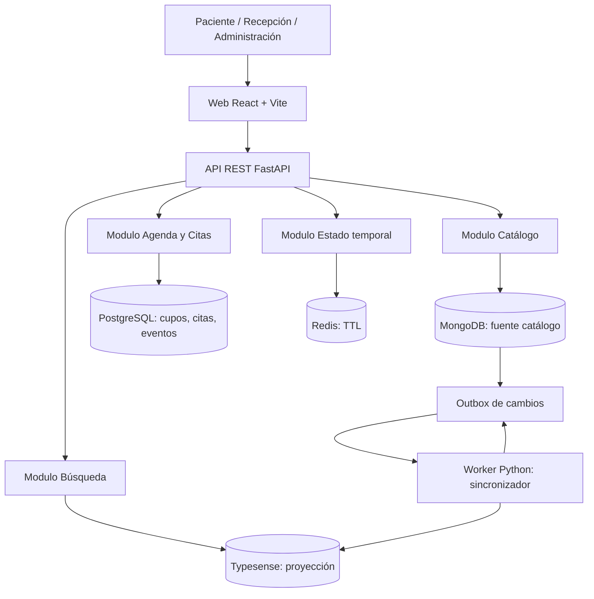
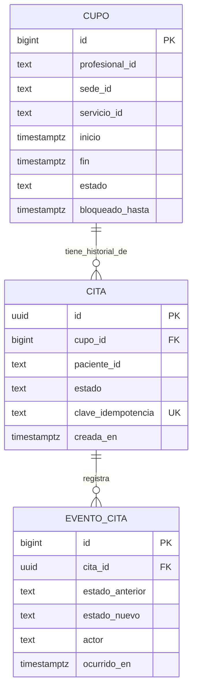
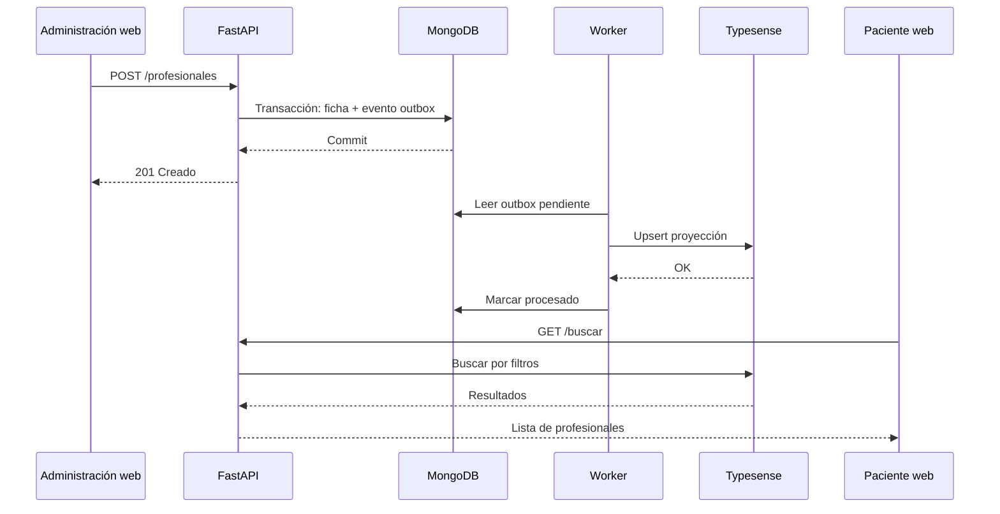

# Fase 3 · Diseño — Clínica ambulatoria

**Grupo 2 · Proyecto A · Persistencia políglota**  
**Estado:** propuesta de diseño para revisión e integración con las fases 1 y 2.

## 1. Objetivo y alcance

Diseñar la solución web para catálogo, búsqueda, disponibilidad, reserva, cancelación y reprogramación de citas ficticias, con controles de concurrencia y trazabilidad. Se mantienen las decisiones de las fases anteriores: **MongoDB 7** (catálogo oficial), **PostgreSQL 16** (cupos, citas e historial), **Typesense 28** (proyección de búsqueda) y **Redis 7** (filtros y borradores temporales). La web será React + Vite; la API FastAPI; el sincronizador Python; el despliegue Docker Compose.

No se incluyen historias clínicas, diagnósticos, pagos ni datos reales.

## 2. Arquitectura lógica



Las reservas **nunca** se confirman desde Redis ni Typesense. La API verifica la actividad del profesional/servicio en MongoDB y efectúa la ocupación atómica del cupo y la creación de cita/evento en PostgreSQL. La verificación en MongoDB y la transacción PostgreSQL **no** son una transacción distribuida; se documenta la ventana de carrera ante desactivaciones simultáneas.

## 3. Identificadores y propiedad de datos

| Identificador | Creador / fuente oficial | Consumidores |
| --- | --- | --- |
| `especialidad_id`, `sede_id`, `profesional_id`, `servicio_id` | MongoDB (catálogo) | PostgreSQL como referencias lógicas; Typesense como proyección |
| `cupo_id` | PostgreSQL | Citas, API, web, borrador Redis |
| `cita_id` (UUID) | PostgreSQL | Web y eventos de cita |
| `paciente_id` (identidad ficticia) | Módulo de autenticación; almacenamiento a definir en implementación | PostgreSQL, autorización |
| `clave_idempotencia` | Cliente al enviar la solicitud; unicidad y asociación validadas por PostgreSQL | API de citas |
| `evento_outbox_id` | MongoDB, escritura junto al cambio de catálogo | Worker de sincronización |

**Regla de integración:** no hay claves foráneas entre MongoDB y PostgreSQL; la API valida las referencias al crear cupos o citas. La disponibilidad siempre se lee desde PostgreSQL.

## 4. Modelo de catálogo — MongoDB

Colecciones propuestas (estructura exacta por fijar en los esquemas de implementación):

| Colección | Campos esenciales | Índices propuestos |
| --- | --- | --- |
| `especialidades` | `_id`, `nombre`, `activo` | nombre normalizado único |
| `sedes` | `_id`, `nombre`, `direccion_ficticia`, `ubicacion`, `activo` | nombre normalizado único |
| `profesionales` | `_id`, `nombre`, `especialidad_ids[]`, `sedes[]`, `idiomas[]`, `modalidades[]`, `horarios_referencia[]`, `activo`, `actualizado_en`, `version` | `especialidad_ids`, `activo`, `sedes.sede_id` |
| `servicios` | `_id`, `nombre`, `especialidad_id`, `duracion_minutos`, `modalidades[]`, `activo` | `especialidad_id`, `activo` |
| `outbox` | `_id`, `tipo`, `entidad_id`, `version`, `creado_en`, `procesado_en`, `intentos`, `ultimo_error` | `(procesado_en, creado_en)`, `(entidad_id, version)` |

Un profesional puede poseer atributos variables. Se recomienda `$jsonSchema` para requeridos y tipos, índices únicos para nombres donde aplique y **borrado lógico** mediante `activo=false`. El evento de outbox se crea dentro de la **misma transacción MongoDB** que la mutación del catálogo; requiere replica set configurado para transacciones.

Ejemplo ilustrativo de un profesional ficticio:

```json
{
  "_id": "prof-001",
  "nombre": "Dra. Lucía Andrade",
  "especialidad_ids": ["esp-cardio"],
  "sedes": [{"sede_id": "sede-norte", "horario_ref": "L-V 08:00-13:00"}],
  "idiomas": ["es", "en"],
  "modalidades": ["PRESENCIAL"],
  "activo": true,
  "version": 1
}
```

## 5. Modelo transaccional — PostgreSQL

Se aprovecha la prueba de concepto `poc/01_postgres_concurrencia.py` como referencia, **sin convertirla directamente en esquema de producción**.



Restricciones a implementar:

- `CHECK (fin > inicio)` y estados permitidos.
- `EXCLUDE USING gist (profesional_id WITH =, tstzrange(inicio, fin) WITH &&)` con extensión `btree_gist`, para impedir solapes.
- Índice único parcial de `cita(cupo_id)` cuando el estado sea `PENDIENTE` o `CONFIRMADA`.
- `UNIQUE (clave_idempotencia)`, con comprobación adicional de que una clave reutilizada corresponde a la **misma solicitud/paciente**, sin revelar una cita de otra persona.
- Índices para `cupo(profesional_id, inicio)` y `cita(paciente_id, creada_en)`.
- `evento_cita` es append-only para trazabilidad; la cancelación no borra ni la cita ni sus eventos.

**Estados acordados en fase 1:** cupo `DISPONIBLE`, `BLOQUEADO`, `RESERVADO`; cita `PENDIENTE`, `CONFIRMADA`, `CANCELADA`. La reprogramación debe reflejarse mediante cambio del `cupo_id` y un evento trazable; si se requiere identificarla como estado adicional, el equipo debe actualizar conjuntamente las máquinas de estado y contratos. El bloqueo temporal (`bloqueado_hasta`) **vive en PostgreSQL**, no Redis.

### Operaciones críticas

1. **Reservar:** validar catálogo activo; transacción PostgreSQL con `UPDATE cupo ... WHERE estado='DISPONIBLE' RETURNING id`; insertar cita y evento; `201` si gana, `409` si ya está ocupado.
2. **Cancelar:** bloquear la cita; verificar permiso y estado; cambiar a `CANCELADA`, liberar cupo e insertar evento dentro de una sola transacción.
3. **Reprogramar:** bloquear cita y ambos cupos en orden fijo, comprobar disponibilidad del destino, ocupar nuevo, liberar anterior, actualizar cita e insertar evento en una transacción; si falla, rollback completo.
4. **Confirmar:** solo recepción; actualizar `PENDIENTE` → `CONFIRMADA` e insertar evento atómicamente.
5. **Hold:** asignación consistente en PostgreSQL con vencimiento y recuperación de bloqueos expirados; su transición exacta y proceso de limpieza deben concretarse antes de implementar.

## 6. Modelo de búsqueda — Typesense

Una colección derivada `profesionales` por profesional activo: `id`, `nombre`, `especialidades[]`, `sedes[]`, `idiomas[]`, `modalidades[]`, `servicios[]`, `activo`, `ubicacion`. Campos de filtros/facetas y texto inspirados en `poc/03_typesense_busqueda.py`.

**Sincronización propuesta (outbox):**

1. El administrador modifica profesional o servicio en MongoDB; se registra un evento de outbox en la misma transacción.
2. El worker consulta eventos pendientes, reconstruye el documento desde la **fuente oficial**, y aplica `upsert` o eliminación en Typesense.
3. Solo cuando Typesense responde satisfactoriamente, se marca el evento como procesado.
4. Reintentos con backoff ante errores; operación idempotente por entidad/version; las versiones evitan que un evento viejo sobrescriba el nuevo.
5. Se documenta un comando de **reindexación completa** desde MongoDB si el índice se pierde.

Tipos de fallos: Typesense indisponible → búsqueda degradada, eventos pendientes; Redis indisponible → se pierden filtros/borradores, no citas; PostgreSQL indisponible → no se confirma reserva; MongoDB indisponible → no se modifica catálogo y la API no puede garantizar la validación de estado activo en nuevas reservas.

## 7. Modelo efímero — Redis

Claves propuestas: `filtros:{sesion_id}` y `borrador:{sesion_id}` como hashes con TTL (por defecto 1800 segundos según `.env.example`). No son datos autoritativos. Nunca almacenar credenciales sensibles o decisiones finales de ocupación en Redis.

## 8. Contratos REST propuestos

Estos endpoints son **diseño**, no implementación existente.

| Método | Ruta | Rol | Resultado principal / errores |
| --- | --- | --- | --- |
| GET | `/health` | Público (sin secretos) | Estado API y dependencias, `200`/`503` según política |
| POST | `/especialidades` | Administrador | Crear, `201`; inválido `422`, duplicado `409` |
| POST | `/sedes` | Administrador | Crear, `201` |
| POST | `/profesionales` | Administrador | Crear + outbox, `201` |
| PATCH | `/profesionales/{id}` | Administrador | Editar/desactivar + outbox, `200` |
| POST | `/servicios` | Administrador | Crear servicio, `201` |
| GET | `/profesionales/{id}` | Autenticado | Ficha catálogo, `200`/`404` |
| GET | `/buscar?q=&especialidad_id=&sede_id=` | Público o autenticado | Resultados Typesense, `200`; degradación `503` |
| POST | `/cupos` | Recepción / Administrador | Publicar franjas, `201`/`409` |
| GET | `/cupos?profesional_id=&sede_id=&desde=&hasta=` | Autenticado | Franjas desde PostgreSQL, `200` |
| POST | `/citas` | Paciente / Recepción | Reservar con `Idempotency-Key`, `201`/`200` reintento/`409` conflicto |
| GET | `/citas/mias` | Paciente | Solo citas propias, `200` |
| PATCH | `/citas/{id}/cancelar` | Propietario / Recepción | Cancelar, `200`/`403`/`409` |
| PATCH | `/citas/{id}/confirmar` | Recepción | Confirmar, `200`/`409` |
| PATCH | `/citas/{id}/reprogramar` | Según matriz de roles acordada | Nuevo cupo, `200`/`409` |
| PUT/GET | `/sesiones/{id}/filtros` | Propietario de sesión | Guardar/consultar TTL, `200` |

**Ejemplo de reserva (propuesta):**

```http
POST /citas
Idempotency-Key: 4eaa2b95-99d2-4f53-88c2-b5a4164f4b20
Content-Type: application/json

{"cupo_id": 42, "servicio_id": "serv-consulta"}
```

```json
{"cita_id":"a0f2099d-7ac5-4db4-828c-12f78f59e0a1", "estado":"PENDIENTE", "cupo_id":42}
```

El identificador del paciente se obtiene de la identidad autenticada, no se confía en un `paciente_id` arbitrario enviado por el navegador. Aún falta definir el mecanismo mínimo de identidad/roles para la demo, así como la política exacta de respuesta de `/health` y el contrato de las rutas administrativas restantes.

## 9. Flujos end-to-end

### Flujo A: alta y búsqueda



### Flujo B: reserva sin duplicados

```mermaid
sequenceDiagram
    participant A as Paciente A
    participant B as Paciente B
    participant API as FastAPI
    participant M as MongoDB
    participant P as PostgreSQL
    A->>API: POST /citas cupo 42
    B->>API: POST /citas cupo 42
    API->>M: Validar activo
    M-->>API: Activo
    API->>P: Transacción A: ocupar cupo + cita + evento
    API->>P: Transacción B: intentar ocupar mismo cupo
    P-->>API: Una confirma; otra encuentra 0 filas
    API-->>A: 201 (ejemplo ganador)
    API-->>B: 409 franja ocupada
```

La asignación A/B es ilustrativa: cualquiera puede ganar, pero nunca ambas. No se garantiza una transacción ACID entre MongoDB y PostgreSQL.

## 10. Pantallas mínimas y módulos

| Pantalla | Elementos | Endpoints relevantes |
| --- | --- | --- |
| Inicio / buscador | Texto, filtros por especialidad y sede, tarjetas | `GET /buscar` |
| Detalle | Ficha, modalidades, cupos libres | `GET /profesionales/{id}`, `GET /cupos` |
| Reservar | Selección de cupo, confirmación/error visible | `POST /citas` |
| Mis citas | Estado, historial, cancelar/reprogramar | `GET /citas/mias`, PATCH citas |
| Recepción | Agenda, publicar cupos, confirmar, reprogramar | Cupos y citas |
| Administración | CRUD de catálogo, desactivación | Especialidades, sedes, profesionales, servicios |

## 11. Validación y evidencia previstas

1. Crear un profesional en MongoDB y verificar su aparición en Typesense/web.
2. Cambiar sede/especialidad y medir diferencia entre `creado_en` y `procesado_en` del evento outbox.
3. Ejecutar dos reservas simultáneas para el mismo cupo: exactamente una `201`, otra `409`.
4. Cancelar y reservar nuevamente el mismo cupo; conservar evento de la primera cita.
5. Reiniciar contenedores y verificar que citas persisten; detener Typesense y demostrar búsqueda degradada y reintento/reindexación.

## 12. Pendientes de diseño antes de fase 4

- Definir autenticación/roles ficticios y fuente de identidad; proteger acceso a `mis citas`.
- Cerrar política de holds, limpieza por vencimiento y transiciones exactas de estado.
- Precisar contrato de reprogramación y formato de historial de cambio de cupo (anterior/nuevo).
- Definir manejo de cambios simultáneos de actividad catálogo/reserva (no hay transacción distribuida).
- Determinar versionado y orden de eventos de outbox, recuperación de mensajes atascados y reindexación.
- Concretar todos los esquemas Pydantic, ejemplos de error y códigos HTTP antes de implementación.
- Acordar con el equipo si la interfaz necesita autenticación real de demo o perfiles simulados con validaciones del lado API.

**Continuidad con el repositorio:** este documento toma como base `docs/fase1-comprension.md`, `docs/fase2-investigacion.md` y las cuatro pruebas de `poc/`. Los diagramas Mermaid se pueden renderizar y exportar a PNG en una fase posterior.
